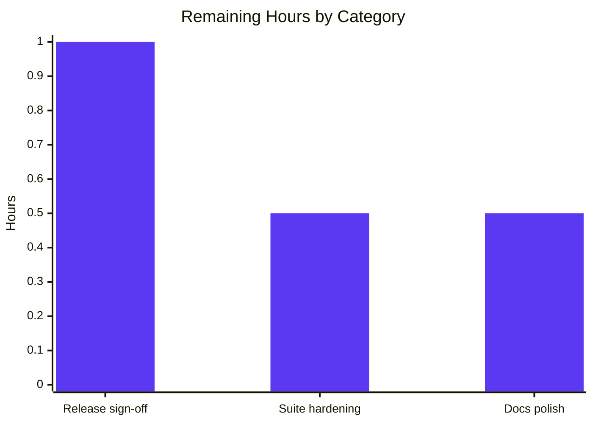

# 1. Executive Summary

## 1.1 Project Overview

`hello_date` is a minimal Python 3.12 command-line tool. Running `python hello_date.py` writes one line to standard output — the greeting `Hello, world`, a single space, and today's date as ISO 8601 (`YYYY-MM-DD`) — exits 0 and leaves standard error empty. There is no server, no database, no configuration, no argument interface and no second behaviour. Its users are the people who asked for it: one command to run, one test to watch pass. The scope is three root-level files: the script, the single pytest test asserting its output, and a short README with the run and test instructions.

## 1.2 Completion Status

**90.0% complete — 18.0 hours completed of 20.0 total hours** (18.0 ÷ (18.0 + 2.0)).


| Metric | Hours |
|---|---|
| Total Hours | 20.0 |
| Completed Hours (AI + Manual) | 18.0 |
| Remaining Hours | 2.0 |

## 1.3 Key Accomplishments

- One-line output contract, byte-verified: 24 bytes, one terminating newline, empty standard error, exit status 0.
- A CLI invocation that ignores every argument and environment value and reads no input.
- Exactly one pytest test, asserting the script's real standard output through a child process.
- Deterministic date assertion: the clock is read before and after the run, so the test cannot flake across midnight.
- A four-part README with copy-able run and test commands and both prerequisites.
- Standard-library-only runtime: nothing to install to run the tool.
- A closed three-file deliverable set, with every excluded artefact class absent.
- No attack surface: no input channel, no network call, no credential, no file write, no shell path.

## 1.4 Critical Unresolved Issues

Nothing blocks delivery: the tool, its test and its README are all present and verified. **10 open items** stand across the 21 requirements assessed — one is a release action and nine are accepted caveats about how the work is exercised, not gaps in what it does.

| Issue | Impact | Owner | ETA |
|---|---|---|---|
| Suite cannot detect a missing terminating newline (1 item) | A future switch to `sys.stdout.write` would keep the suite green while breaking the documented contract | Developer | 0.5 h |
| Guard silence on import, and the unbounded child process, are not asserted (2 items) | Removing the guard, or a script that ever blocked, would not fail the suite | Developer | Covered by the item above |
| README's example line carries a fixed date (1 item) | The example reads as stale on any later day | Developer | 0.5 h |
| Runner caches, the documentation-only dependency pin, the incidental `-m` invocation, the local-date/no-time-zone behaviour, and undefended import-path poisoning (5 items) | Operational friction only; each is deliberate or needs the operator's own environment change | Developer / Operator | No action required |
| Acceptance run and release sign-off on the delivery host (1 item) | The release record is owed | Release engineer | 1.0 h |

## 1.5 Access Issues

No access issues identified. The tool needs no service, credential, API key or third-party account: its only dependency is the standard library, and pytest 9.1.1 is already present. Both acceptance commands run from the repository root.

## 1.6 Recommended Next Steps

1. **[High]** Run `python hello_date.py` and `pytest -q` on the delivery host, confirm the printed date matches that host's local date, and record the sign-off (1.0 h).
2. **[Medium]** Add a byte-level assertion that the output ends in exactly one newline (0.5 h).
3. **[Low]** Reword the README's example as the `Hello, world YYYY-MM-DD` shape (0.5 h).

# 2. Project Hours Breakdown

## 2.1 Completed Work Detail

| Component | Hours | Description |
|---|---|---|
| `hello_date.py` — the tool | 3.0 | Builds the greeting and the run's local ISO date into one line and prints it under a `__main__` guard, with the standard library as its only runtime dependency. Delivers the script named by the request, the single-line output contract (greeting verbatim with its comma, one space, zero-padded `YYYY-MM-DD`, one terminator, empty standard error, exit 0), the file-path invocation, and the prohibition on configuration, arguments, flags, logging and error handling for conditions the tool cannot meet. |
| `test_hello_date.py` — the single pytest test | 4.0 | One test that runs the script as a real child process launched with `sys.executable`, resolves the script's path from the test file's own location, and asserts the line count, the full line shape, the date's value against readings taken on both sides of the run, and empty standard error. Delivers exactly one test with no fixture, class, parametrisation, helper or second test module, and rejects clock-freezing, monkeypatching, an injected date and a hardcoded date. |
| `README.md` — run and test documentation | 1.5 | Four parts: a one-line description of what the tool prints, the prerequisites (Python 3.12 with the `python --version` check, pytest 9.1.1), a Run section holding the literal `python hello_date.py` and the line it prints, and a Test section holding the literal `pytest -q` and the expected `1 passed` summary. No licence text, badges, CI status, architecture notes, contributing section, changelog or API reference. |
| Output-contract verification | 3.5 | Byte, line-count, stream, exit-status and local-clock checks on the running tool, including the exact byte dump, standard error measured by capture rather than by discard, the exit status on every invocation form, and a time-zone sweep showing the printed date follows the host's local clock at call time rather than UTC or a value frozen at import. Also confirms the tool runs with the site directory disabled and in isolated interpreter mode. |
| Suite-strength verification | 2.5 | Confirmatory runs of the automated suite: collected node count, repeated passes, a run from a working directory other than the repository root, and the discriminating power of each assertion shown by mutating the script in disposable copies (greeting punctuation, date format, hardcoded and off-by-one dates, doubled text, an extra line, standard-error noise, a non-zero exit status, a missing script). |
| Scope and structure discipline | 1.5 | Flat three-file root layout with the deliverable set closed exactly as specified, and every excluded artefact class probed absent: manifest, lock file, install script, configuration or environment file, logging or metrics, container or orchestration file, CI workflow or hook, second test, fixture or configuration file for the runner, coverage tooling, linter, formatter or type-checker configuration, packaging or console entry point, and any extra file or directory. |
| Static quality and security review | 2.0 | Line-by-line reading of both Python files for PEP 8 layout and PEP 257 docstrings, an import and output-sink inventory, an input-channel inventory, a secret and dangerous-API sweep over the tree, and an assessment of the one introduced dependency against published advisories. |
| **Total Completed Hours** | **18.0** | 8.5 hours on the three requested deliverables themselves and 9.5 hours verifying, hardening and reviewing them. |

## 2.2 Remaining Work Detail

| Category | Hours | Priority |
|---|---|---|
| Deployment acceptance run and release sign-off on the target host | 1.0 | High |
| Suite hardening: assert the terminating newline at the byte level | 0.5 | Medium |
| Documentation polish: state the README example as a shape, not a fixed date | 0.5 | Low |
| **Total Remaining Hours** | **2.0** | |

# 3. Test Results

Every row below was executed against the delivered tree at the commit under review; the counts are from those runs. In total **22 executed checks passed, 0 failed**.

| Area / Category | Framework | Tests | Passed | Failed | Coverage | What This Proves |
|---|---|---|---|---|---|---|
| Single-line output contract | Command-level checks under CPython 3.12.15 | 6 | 6 | 0 | The tool's entire observable behaviour | The documented command writes exactly one 24-byte line — `Hello, world YYYY-MM-DD` plus a single newline — exits 0 and leaves standard error empty |
| Local-clock semantics | Command-level checks (time-zone sweep, five zones) | 5 | 5 | 0 | Not measured | The printed date is the host's local date read at call time, not a UTC conversion and not a value captured at import |
| Invocation and environment insensitivity | Command-level checks (argument and environment variants) | 4 | 4 | 0 | Not measured | No argument, flag or environment value alters the output or the exit status |
| Runtime dependency isolation | Command-level checks with the site directory disabled and in isolated mode | 2 | 2 | 0 | Not measured | Nothing outside the standard library is needed to run the tool |
| Import safety | Command-level check (`import hello_date`) | 1 | 1 | 0 | Not measured | Importing the module writes nothing and exits 0, so the `__main__` guard holds |
| Automated suite (`test_hello_date.py`) | pytest 9.1.1 | 1 | 1 | 0 | No coverage tooling is configured; the single test asserts the whole output | The script's real standard output, its shape, the date's value and empty standard error are asserted through a genuine child process |
| Suite discovery and stability | pytest 9.1.1 | 3 | 3 | 0 | Not measured | A bare `pytest` at the repository root collects exactly one test with no configuration file, and it passes from any working directory |

Coverage is reported as a fact rather than a percentage: no coverage tooling is configured, installed or permitted in this project, so no instrumented figure exists. The qualitative statement is stronger than a percentage would be here — the one test asserts the whole of the tool's observable behaviour, and the command-level checks above cover the parts of the contract a child-process assertion cannot see.

**Not Covered** — capabilities that are delivered but that no test exercises, with what a human should check before release:

- **The terminating newline byte.** The suite asserts one logical line via `splitlines()`, which yields the same result with or without the trailing newline. The byte is currently verified by running the command and counting bytes. To close it, add an assertion on the raw output (for example that `result.stdout` ends with exactly one `\n`) — the work item in Section 2.2.
- **The `__main__` guard's silence on import.** No test would fail if the guard were removed, because the guard's effect is invisible to a child process launched as a script. A human should re-check that `python -c "import hello_date"` prints nothing after any change to the module's top level.
- **A UTC-instead-of-local clock.** The date-value assertion accepts a UTC date whenever the local and UTC dates coincide, which is most of the day. The time-zone sweep catches it; a human should keep that sweep or add a zone where the two dates differ to the pre-release check.
- **A blocking child process.** The child is launched without a timeout, so a future change that made the script wait would hang the runner rather than fail it. Not a defect today: the tool performs one `print` and blocks on no input.
- **Platforms other than Linux with CPython 3.12.** The behaviour was verified on this host's Linux under CPython 3.12.15 (and the tool also runs correctly under the host's 3.13). Anything you deploy to a different operating system should be re-checked for the same command, the same line and the same exit status.

# 4. Runtime Validation & UI Verification

- ✅ **Documented run** — `python hello_date.py` from the repository root printed `Hello, world 2026-10-20`: 24 bytes, one line, exactly one terminating newline, 0 bytes on standard error, exit status 0.
- ✅ **Local-clock behaviour** — across five time zones the printed date was each zone's own local date (the two zones west of UTC printed the previous day while UTC and the two eastern zones printed the current one), and a date re-read after a time-zone change inside one process returned the new value, so the clock is read at call time.
- ✅ **Import path** — importing the module wrote nothing to either stream and exited 0, so the guard suppresses script-only behaviour on import.
- ✅ **Standard-library-only execution** — the tool printed the contracted line with the site directory disabled and in isolated interpreter mode, confirming nothing outside the standard library is required.
- ✅ **Argument and environment insensitivity** — `--help`, two positional words, an environment override and a completely empty environment each produced the byte-identical line with the same exit status, so no argument or environment value changes the behaviour.
- ✅ **Automated suite** — `pytest -q` collected exactly one test and reported `1 passed`, exit 0; the same result was obtained with the test invoked from a working directory outside the repository.
- ✅ **Documented commands** — the Run and Test commands as the README states them were executed verbatim from the repository root and reproduced the line and the `1 passed` summary the README documents.
- ✅ **Working-tree hygiene after runs** — repeated runs left the tree holding exactly the three delivered files; the tool created, modified and deleted nothing.
- ⚠ **Interpreter resolution** — the host's bare `python` is 3.13.7, which also runs the tool correctly, but the project pins Python 3.12; the documented `python --version` check is what reveals a mismatch, and the suite is immune because it launches the script with the interpreter running the test.
- ⚠ **Runner caches** — a plain `pytest -q` writes `__pycache__/` and `.pytest_cache/` into the checkout because no ignore file ships by design; both are artefacts of the test runner rather than of the tool.

**Never exercised at runtime.** The product has no web, graphical or terminal user interface — its entire output is one line of plain text — so no page, screen, endpoint or service was driven, and none exists to drive. There is no external integration to exercise: the tool opens no socket, reads no file or standard input, reads no stream from a caller and consults no environment value. Three further cases were not exercised directly: a genuine midnight rollover during a single run (the two-sided date bracket and the time-zone sweep stand in for it), any host other than this Linux environment, and the tool under an interpreter other than CPython 3.12 (it was run under the host's 3.13 as a portability spot-check only, not as a supported target).

# 5. Compliance & Quality Review

## 5.1 Compliance Matrix

| # | Deliverable / Requirement | Status | Verified By |
|---|---|---|---|
| 1 | Script `hello_date.py` at the repository root, invoked as `python hello_date.py` | ✅ PASS | File present at the root (commit `83ca73c`); the command was run and printed the contracted line with exit status 0 |
| 2 | One-line output contract: greeting verbatim, one space, local `YYYY-MM-DD`, one terminator, empty standard error, exit 0 | ✅ PASS | Byte dump (24 bytes, one `\n`), line count, standard error by capture, exit status, and a five-zone time-zone sweep |
| 3 | Exactly one pytest test asserting that output | ✅ PASS | `pytest --collect-only -q` lists one node, `test_hello_date.py::test_hello_date_output`; no second test, fixture, class, parametrisation or configuration file exists |
| 4 | The test asserts the script as a real process and stays deterministic | ✅ PASS | `1 passed` on repeated runs and from a foreign working directory; the date is read before and after the run, and a stale date fails the assertion |
| 5 | Four-part README with copy-able run and test instructions and both prerequisites | ✅ PASS | Both documented commands executed verbatim and reproduced the documented results; `python --version` and `pytest --version` match the stated prerequisites |
| 6 | Standard-library-only runtime; nothing to install to run the tool | ✅ PASS | The sole import is `datetime`; the tool runs with the site directory disabled and in isolated interpreter mode |
| 7 | Python 3.12 as the interpreter, declared where a reader learns it | ✅ PASS | All runs under CPython 3.12.15; the README names 3.12 and gives the check command |
| 8 | Pinned test runner recorded in the documented prerequisites | ✅ PASS | README states pytest 9.1.1 as an exact pin; the installed runner is pytest 9.1.1 |
| 9 | Closed three-file deliverable set with every excluded artefact class absent | ✅ PASS | The tree holds exactly `hello_date.py`, `test_hello_date.py`, `README.md`; manifest, configuration, container, CI, coverage, linter, packaging, second test and extra-directory probes all absent |
| 10 | PEP 8 layout and PEP 257 docstrings on module and function, with no style configuration added | ✅ PASS | Both Python files read line by line: four-space indentation, no tabs, ≤79-column lines, two blank lines around each top-level definition, one-line period-ended docstrings |
| 11 | Security posture: no untrusted input, network access, credentials or filesystem writes | ✅ PASS | No input channel, no network call, no secret-pattern match, no file write; the only child process uses an argument list with no shell |
| 12 | Acceptance evidence: both commands and their observable results | ✅ PASS | `python hello_date.py` → one line, exit 0, empty standard error; `pytest -q` → one test collected, `1 passed`, exit 0; no other artefact is needed |

## 5.2 AAP & Rule Divergences and Gaps

Five divergences from the planned work were identified: four carry no remaining work, and one leaves a verification gap worth closing. No user rules exist for this project, so no rule divergence is possible and none was identified — the rules document is empty, and the enterprise standards that govern in its place are met by rows 10 and 11 above.

| # | What the Plan Required | What Was Delivered Instead | Why It Diverged | Impact | Remediation |
|---|---|---|---|---|---|
| 1 | All three deliverables created in a repository that does not yet exist | `README.md` replaced in place over the tracked two-line placeholder (commit `b55d7dd`, +36/−2); the other two files added | The repository already tracked that path when the work began, so a creation was impossible; the plan's own file specification was corrected to an in-place replacement before the file was written | None on the deliverable — the README's four parts are delivered and no placeholder text survives; only the plan's prose is inaccurate | None required |
| 2 | The illustrative output line shown as `Hello, world 2026-10-19` | `Hello, world 2026-10-20` in the README's example block | The example was set to the day the tool actually ran on the delivery host; no requirement fixes an example's value, only its shape | Cosmetic: the example reads as stale on any later day, though the shape it demonstrates stays correct | 0.5 h — Section 2.2 |
| 3 | The structure uses no `-m` module execution (§0.2.2) | `python -m hello_date` from the repository root executes the module and prints the line; `python -m hello_date.py` fails with exit 1 | Any importable root-level module can be executed by the interpreter's runpy path while the working directory is on the import path; no `-m` interface ships, and removing the behaviour would need a package or file the closed file list forbids | None on the documented invocation; a literal reading of that plan section is misleading | None required |
| 4 | The test module's closed content inventory (§0.6.1 component 2) | The test carries two one-line PEP 257 docstrings the inventory did not enumerate, an unannotated signature, and `subprocess.run`'s arguments wrapped one per line instead of on one line | The plan's own quality standards make module-and-function docstrings governing where no user rules exist, and PEP 8's 79-column rule governs the call's formatting — same call, same arguments, same keywords | None behavioural; the file differs cosmetically from the plan's snippet | None required |
| 5 | Exactly one terminating newline on the printed line (§0.3.4) | The newline is delivered by the single `print` and verified by running the command (24 bytes, one `\n`), not by the suite: the prescribed assertions use `splitlines()`, which cannot see it | The plan splits this verification deliberately, assigning the newline to the acceptance run check rather than to the test | A future change from `print` to `sys.stdout.write` would keep the suite green while breaking the documented contract | 0.5 h — Section 2.2 |

**Divergence 1 — the README's delivery operation.** The plan describes the project as built from scratch, but the checkout already tracked a single file: a two-line auto-created placeholder `README.md`. A creation was therefore impossible, and the delivered file replaces those two lines in full — the placeholder's title and its "Auto-created public repository with README" line are gone, no fragment survives anywhere in the tree, and the 36-line result carries the four parts the request asked for. The named path, purpose, content type and priority all match the plan's row, so nothing needs to be done; the only consequence is that the phrase "created" in the plan should be read as "delivered at this path" if the plan is consulted later (`README.md`, commit `b55d7dd`).

**Divergence 2 — the README's example date.** The plan illustrates the printed line with a run date of 19 October 2026; the README shows `Hello, world 2026-10-20` (README.md:18-22), the date the tool actually printed on the delivery host. No requirement fixes an example's value — the plan fixes the `Hello, world YYYY-MM-DD` shape, which the line shown satisfies — and an example that matches a real run is truthful where a fabricated date would not be. The cost is that the example will look stale to a reader who comes back later. Rewording it to the shape (`Hello, world YYYY-MM-DD`) takes about half an hour and removes the effect entirely; it is a documentation choice for you, not a defect.

**Divergence 3 — `-m` execution.** The plan describes the structure as not using `-m` module execution; in practice `python -m hello_date`, run from the repository root, executes the module and prints the line, because the interpreter can run any importable root-level module file once the working directory is on the import path. Nothing ships to support it: there is no package, no `__main__.py` and no console entry point, and `python -m hello_date.py` fails with exit 1 exactly as a file-path CLI should. Removing the incidental behaviour would require adding a file the closed deliverable set forbids. Treat the documented `python hello_date.py` as the interface; the `-m` form is an interpreter property rather than a feature of this tool (`hello_date.py`, §0.2.2 of the plan).

**Divergence 4 — the test module's extra docstrings and formatting.** The plan enumerates the test file's contents and does not list docstrings, but the same plan's quality standards require one-line PEP 257 docstrings on a module and on each function, and they govern because no user rules exist. The delivered file therefore carries a module docstring and a function docstring, leaves the test's signature as the plan wrote it, and wraps the `subprocess.run` call one argument per line to stay inside the 79-column limit — the same call with the same arguments and keywords. Every enumerated element is present and every enumerated absence holds: one test function, no fixture, no class, no parametrisation, no helper, no second test module. No action is needed (`test_hello_date.py:1, 13, 15-20`).

**Divergence 5 — the newline the suite cannot see.** The output contract requires exactly one terminating newline, and the suite's one-line assertion uses `splitlines()`, which returns a single element whether or not the newline is there — so the assertion set the plan prescribes cannot fail on a missing terminator. The newline itself is delivered by the single `print` and is verified by running the command and counting bytes: 24 bytes, one `\n`, nothing else. The practical exposure is narrow but real: a future edit that replaced `print` with `sys.stdout.write`, or dropped the terminator deliberately, would leave the suite passing while breaking the documented contract. Adding a byte-level assertion costs about half an hour and closes it (`test_hello_date.py:23-24`, `hello_date.py:12`).

# 6. Risk Assessment

| Risk | Category | Severity | Probability | Mitigation | Status |
|---|---|---|---|---|---|
| A future edit could break the terminating newline while the suite stays green, because the one-line assertion uses `splitlines()` | Technical | Low | Low | Add a byte-level assertion on the raw output (Section 2.2); until then verify the byte count when cutting a release | Open |
| The child process is launched without a timeout, so a script that ever blocked would hang the test runner instead of failing | Technical | Low | Low | Revisit if the tool ever gains input, a file or a network call; today it performs one `print` and waits on nothing | Accepted |
| The pinned runner version lives only in the README, so nothing in the checkout enforces it and the environment is not reproducible from the repository alone | Operational | Low | Medium | None required while the closed file list stands — the test uses only long-stable runner behaviour; note the version when provisioning an environment | Accepted |
| A plain `pytest -q` writes `__pycache__/` and `.pytest_cache/` into the checkout | Operational | Low | High | Run the suite with bytecode writing disabled and a cache directory outside the repository when a pristine tree matters | Accepted |
| The documented invocation depends on `python` resolving to a 3.12 interpreter; on a host where it does not, a different minor runs the tool | Operational | Medium | Medium | The README's `python --version` check is the detector; put the 3.12 interpreter first on `PATH` or call it by absolute path | Open |
| The printed date is the host's local date with no time-zone qualifier, so the same instant yields different output on hosts in different zones | Operational | Low | High | Compare any recorded output against the local date in the same window; the behaviour is what the request asked for | Accepted |
| `./hello_date.py` fails with exit 126 (no shebang, no execute bit) and `python -m hello_date` runs the module although no module interface ships | Technical | Low | Low | Use the documented command; no change is available inside the closed deliverable set | Accepted |
| A `PYTHONPATH`-injected module named `datetime` shadows the standard-library module and aborts the run | Security | Low | Low | Requires the operator to poison their own import path; a standard-library-only program cannot defend against it without a vendored dependency the scope excludes | Accepted |

No other security risk exists: the tool opens no socket, reads no input from any channel, holds no credential and writes no file, and the only dependency introduced for development is the pinned test runner, which is outside its one published advisory (an issue in versions below 9.0.3). No integration risk is carried: the product talks to no external system, and its only integration seam — the test launching the script as a child process — is exercised on every suite run.

# 7. Visual Project Status




| Status | Value |
|---|---|
| Completion | 90.0% |
| Completed hours | 18.0 |
| Remaining hours | 2.0 |
| Total hours | 20.0 |
| Remaining work items | 3 |
| Of those, needing release action | 1 (High priority) |
| Of those, optional polish | 2 (Medium and Low priority) |

# 8. Summary & Recommendations

The project asked for three things and delivered all three: a minimal Python 3.12 command-line tool that prints `Hello, world` and today's date as one line, exactly one pytest test asserting that output, and a short README carrying the run and test instructions. `hello_date.py` builds the line in a single function and prints it under a `__main__` guard, so importing the module has no effect and the date is read at the moment of the call rather than frozen at import. Its only runtime dependency is the standard library; its interface is one command, one line of text and an exit status. Measured against the planned work, **90.0% is complete — 18.0 of 20.0 hours** — with the outstanding 2.0 hours being a release acceptance run and sign-off (1.0 h) and two optional polish items (0.5 h each). Nothing in the plan is unimplemented and no requested deliverable is short.

What was exercised to prove it works is broader than the single test. The documented command was run and its output measured byte by byte: 24 bytes, one terminating newline, exactly one line, 0 bytes on standard error, exit status 0. The line was checked against the host's clock across five time zones, and the printed date followed each zone's local date rather than UTC, which is what the output contract requires. The tool was run with the site directory disabled, in isolated interpreter mode, with a completely empty environment, and with stray arguments including `--help`, each time producing the identical line. Importing the module produced no output at all. The suite itself was run from the repository root and from a working directory outside it: one test collected, `1 passed`, exit 0 on every run. Twenty-two executed checks passed and none failed, and no coverage percentage is quoted because none is instrumented — the one test asserts the whole of what the tool does, and the remaining checks cover the parts of the contract a child-process assertion cannot see.

The gaps are narrow and named. The suite cannot detect a missing terminating newline, because its one-line assertion uses `splitlines()`; the newline is delivered and verified by running the command, but a future edit could break it while the suite stayed green. The guard's silence on import has no test, a UTC-instead-of-local clock would only be caught for part of the day, and the child process has no timeout. The README's example shows a fixed date and will read as stale later, and it was written over an auto-created placeholder rather than created fresh — a detail of how the checkout began, not of what it now contains. Five divergences from the plan are set out in Section 5.2, four of them settled or cosmetic and one — the unasserted newline — carrying the 0.5-hour remedy.

Production readiness for the product as specified is high. It is a single-purpose, standard-library-only command that holds no state, reads no input, calls no service, stores no credential and writes no file, so there is no attack surface, nothing to configure, nothing to monitor and no operational role to fill. The residual risks in Section 6 are the ordinary consequences of its own design decisions: the local-date semantics, the documentation-only dependency pin, runner caches in the checkout, and the fact that `python` must be the pinned minor. The critical path to release is short and human: run the two documented commands on the host where the tool will be used, confirm the printed date matches that host's local date, and record the sign-off. The two 0.5-hour items — a byte-level newline assertion and rewording the README example as a shape — are worth doing at the same time, but neither gates delivery.

| Metric | Value |
|---|---|
| Planned work complete | 90.0% (18.0 of 20.0 hours) |
| Requested deliverables delivered | 3 of 3 |
| Executed checks passed | 22 of 22 |
| Automated tests | 1 collected, 1 passed, 0 failed |
| Open items | 10, of which 1 needs release action |
| Remaining effort | 2.0 hours |

# 9. Development Guide

## System prerequisites

- **CPython 3.12** — the interpreter the tool targets; confirmed here as CPython 3.12.15.
- **pytest 9.1.1** — the single development dependency, and the version the README pins; confirmed here as pytest 9.1.1.
- Any operating system with a 3.12 interpreter. The project was verified on Linux.
- No database, cache, message queue, container runtime or service is needed, and the project opens no port.

## Environment setup

The project needs exactly one thing on `PATH`: a CPython 3.12 interpreter that also has pytest installed. If your `python` and `pytest` already come from such an interpreter, nothing needs to be set up — skip to the checks below. Otherwise, prepend that interpreter's `bin` directory to `PATH` so both commands resolve to it, or call that interpreter by its absolute path in every command.

Confirm both tools before continuing; this is the check the README documents:

```bash
python --version       # expect: Python 3.12.x
pytest --version       # expect: pytest 9.1.1
```

If `python --version` reports a different minor version — the host's bare `python` is 3.13.7, which runs the tool correctly but is not the pinned interpreter — use the 3.12 interpreter explicitly. No file in the repository needs to change in either case, and the tool itself reads no environment variable.

## Dependency installation

None. The tool's only import is `datetime` from the standard library, so `python hello_date.py` runs with nothing installed. The test needs pytest, which is already present in this environment; there is deliberately no manifest, lock file, virtual-environment definition or install script to run, so no install step can fail. If you want a separate environment for experiments of your own, create it outside the repository rather than inside it.

## Application startup

There is no service to start and no port to open: the tool runs to completion in milliseconds and exits. Run it from the repository root, which is what the README documents:

```bash
python hello_date.py
```

Expected: a single line on standard output, for example `Hello, world 2026-10-20`, and nothing else.

## Verification steps

Run the automated suite from the repository root:

```bash
python -m pytest -q
```

Expected: one test collected and reported as passed — `. [100%]` followed by `1 passed in <time>s`, with exit status 0.

To confirm that discovery needs no configuration file, and that exactly one test exists:

```bash
python -m pytest --collect-only -q
```

Expected: a single node, `test_hello_date.py::test_hello_date_output`, and `1 test collected`.

To keep the working tree pristine — a plain `pytest -q` writes `__pycache__/` and `.pytest_cache/` into the checkout, since no ignore file ships — disable bytecode writing and point the runner's cache outside the repository:

```bash
python -B -m pytest -q -o cache_dir=../pytest-cache
```

The same commands work from any working directory, because the test resolves the script's path from its own location rather than from the caller's directory.

## Example usage

Check the exact bytes and the state of each stream:

```bash
python hello_date.py | od -c                    # 24 bytes: the line plus one \n
python hello_date.py 2>&1 >/dev/null | wc -c    # 0 — standard error is empty
```

Check that the printed date is the host's local date, by running the tool under another time zone and comparing with that zone's own clock:

```bash
TZ=Etc/GMT+12 python hello_date.py              # previous day when the zone is behind UTC
python hello_date.py                            # the host's local date
```

Check that the tool is insensitive to arguments and to the environment, and that it needs only the standard library:

```bash
python hello_date.py --help                     # same line, no usage message
env -i "$(command -v python)" hello_date.py     # empty environment
python -S hello_date.py                         # site directory disabled
python -I hello_date.py                         # isolated interpreter mode
```

Import the module and build the line in-process — this is what the `__main__` guard keeps silent when the file is merely imported:

```bash
python -B -c "import hello_date; print(hello_date.hello_date_line())"
```

## Troubleshooting

| Symptom | Cause and resolution |
|---|---|
| `python --version` prints anything other than 3.12.x | `python` on `PATH` is not the pinned interpreter. Put the 3.12 interpreter's `bin` directory first on `PATH`, or call it by absolute path. The tool also runs under 3.13, but 3.12 is what this project targets. |
| `pytest: command not found`, or the suite does not run | pytest is not installed for the interpreter you are using. Install pytest 9.1.1 for that interpreter, or select an interpreter that already has it. |
| `no tests ran`, exit status 5 | The suite was invoked from a directory that cannot see the test, or the test file was renamed. Run `python -m pytest -q` from the repository root; the filename must match the `test_*.py` pattern for a bare invocation to collect it. |
| `./hello_date.py: Permission denied`, exit status 126 | The file carries no shebang and no execute bit, and none is intended: the documented invocation is `python hello_date.py`. |
| `ModuleNotFoundError: __path__ attribute not found on 'hello_date'` when using `python -m hello_date.py` | The `-m` flag takes a module name, not a filename. Omit `-m` and pass the path (`python hello_date.py`), or use the module name (`python -m hello_date`), which runs the same code. |
| The printed line differs from the README's example | Expected: the tool prints the run's own date. The README's example line is illustrative; the shape `Hello, world YYYY-MM-DD` is the contract. |
| `git status` shows `__pycache__/` or `.pytest_cache/` after running the suite | The test runner's own caches. Run the suite as shown in Verification steps (`python -B -m pytest -q -o cache_dir=../pytest-cache`) or delete the two directories. |
| The line's date looks a day off from a UTC clock | By design: the tool prints the machine's local date, with no UTC conversion and no time-zone configuration. |

# 10. Appendices

## A. Command Reference

All commands run from the repository root; each was executed against this tree with the results shown.

| Command | Purpose | Observed result |
|---|---|---|
| `python --version` | Confirm the interpreter | `Python 3.12.15` |
| `pytest --version` | Confirm the test runner | `pytest 9.1.1` |
| `python hello_date.py` | Run the tool | `Hello, world 2026-10-20`, exit 0, empty standard error |
| `python hello_date.py \| wc -c` | Count the output bytes | `24` |
| `python hello_date.py \| wc -l` | Count the output lines | `1` |
| `python hello_date.py \| od -c` | Dump the output bytes | `H e l l o ,   w o r l d   2 0 2 6 - 1 0 - 2 0 \n` |
| `python hello_date.py 2>&1 >/dev/null \| wc -c` | Measure standard error alone | `0` |
| `pytest -q` | Run the suite as documented | `1 passed in 0.02s`, exit 0 |
| `python -m pytest -q` | Run the suite through the interpreter | `1 passed in 0.02s`, exit 0 |
| `python -m pytest --collect-only -q` | Count collected tests | `test_hello_date.py::test_hello_date_output`, `1 test collected` |
| `python -B -m pytest -q -o cache_dir=../pytest-cache` | Run the suite without writing into the checkout | `1 passed`, exit 0, tree unchanged |
| `python -B -c "import hello_date"` | Confirm import silence | 0 bytes on both streams, exit 0 |
| `python -B -c "import hello_date; print(hello_date.hello_date_line())"` | Build the line in-process | `Hello, world 2026-10-20` |
| `TZ=Etc/GMT+12 python hello_date.py` | Exercise the local-clock read | `Hello, world 2026-10-19` |
| `python -S hello_date.py` | Run with the site directory disabled | the contracted line, exit 0 |
| `python -I hello_date.py` | Run in isolated interpreter mode | the contracted line, exit 0 |
| `env -i "$(command -v python)" hello_date.py` | Run with an empty environment | the contracted line, exit 0 |
| `python hello_date.py --help` | Confirm that arguments are ignored | the contracted line, no usage message |

## B. Port Reference

None. The tool binds no port, opens no socket and starts no service, and it reads no configuration that could name one. Any port check in a release procedure is unnecessary for this project.

## C. Key File Locations

| Path | Role |
|---|---|
| `hello_date.py` | The whole product: one import, `hello_date_line()`, and the `__main__` guard that prints its result. Run as `python hello_date.py`. |
| `test_hello_date.py` | The single test, `test_hello_date_output()`, with the `SCRIPT` path constant it resolves from its own location and the child-process invocation it asserts. |
| `README.md` | The four-part documentation: description, prerequisites, Run, Test. |

## D. Technology Versions

| Component | Version | Notes |
|---|---|---|
| CPython | 3.12.15 | The interpreter the project targets (the Python 3.12 line). The tool also runs correctly under the host's 3.13.7. |
| pytest | 9.1.1 | The only development dependency; pinned in the README and installed here at exactly that version. |
| iniconfig / packaging / pluggy / Pygments | 2.3.1 / 26.3 / 1.7.0 / 2.21.0 | pytest's own support packages, as installed here; none is a dependency of the project. |
| Runtime packages | none | The tool imports only `datetime` from the standard library. |

## E. Environment Variable Reference

The tool reads no environment variable, and the project ships no configuration or `.env` file.

| Variable | Effect on this project |
|---|---|
| `TZ` | None on the tool's code, but it changes the host's local time zone and therefore the date the tool prints. That is the documented behaviour, not a configuration surface. |
| `PATH` | Determines which `python` and `pytest` you invoke; use it to select the pinned 3.12 interpreter. |
| Standard CPython variables (`PYTHONPATH`, `PYTHONWARNINGS`, `PYTHONIOENCODING`, `PYTHONDONTWRITEBYTECODE`, …) | Not consulted by the project. Note that a `PYTHONPATH` entry which shadows a standard-library module will break any Python program, this one included. |

## F. Developer Tools Guide

- **Test runner** — pytest 9.1.1, invoked as `pytest -q` or `python -m pytest -q`. A bare invocation at the root collects the single test with no configuration file; add `-B` and a `cache_dir` outside the repository to keep the tree pristine.
- **Byte-level inspection** — `od -c` to see the exact output, `wc -c` and `wc -l` to count bytes and lines, and stream redirection to separate standard output from standard error when checking the contract.
- **Interpreter switches** — `-S` (no site directory), `-I` (isolated mode), `-B` (no bytecode writing) and `-W error` are useful when confirming that the tool depends on nothing but the standard library and stays silent on standard error.
- **No linter, formatter, type checker or coverage tool** is installed, configured or intended for this project; conformance to PEP 8 and PEP 257 is checked by reading the two Python files, and "coverage" is the single test asserting the whole of the tool's observable behaviour. Do not add configuration for such tools — the deliverable set is deliberately closed at three files.

## G. Glossary

- **CLI tool** — a program run from a shell by typing a command, as opposed to a service, a library or a web application.
- **CPython** — the reference implementation of Python, and the interpreter this project runs on.
- **ISO 8601 date** — the `YYYY-MM-DD` calendar-date form, with zero-padded month and day; the format the tool prints.
- **Local date** — the date according to the host's own time zone, with no UTC conversion.
- **`__main__` guard** — the `if __name__ == "__main__":` block that runs only when the file is executed as a script, so importing the module has no side effect.
- **Standard library** — the modules that ship with Python, such as `datetime`; using only these means nothing has to be installed to run the tool.
- **Child process** — the separate interpreter the test starts to run the script, which is what makes the assertion about the tool's real output honest.
- **Node id** — pytest's name for a collected test, here `test_hello_date.py::test_hello_date_output`.
- **Standard error** — the second output stream; the tool leaves it empty on the success path.
- **Exit status** — the number a process returns to the shell; `0` means success.
- **PEP 8 / PEP 257** — the Python conventions for code layout and for docstrings, which both Python files follow.
- **Cache artefacts** — `__pycache__/` and `.pytest_cache/`, written by the interpreter and the test runner rather than by the tool.
